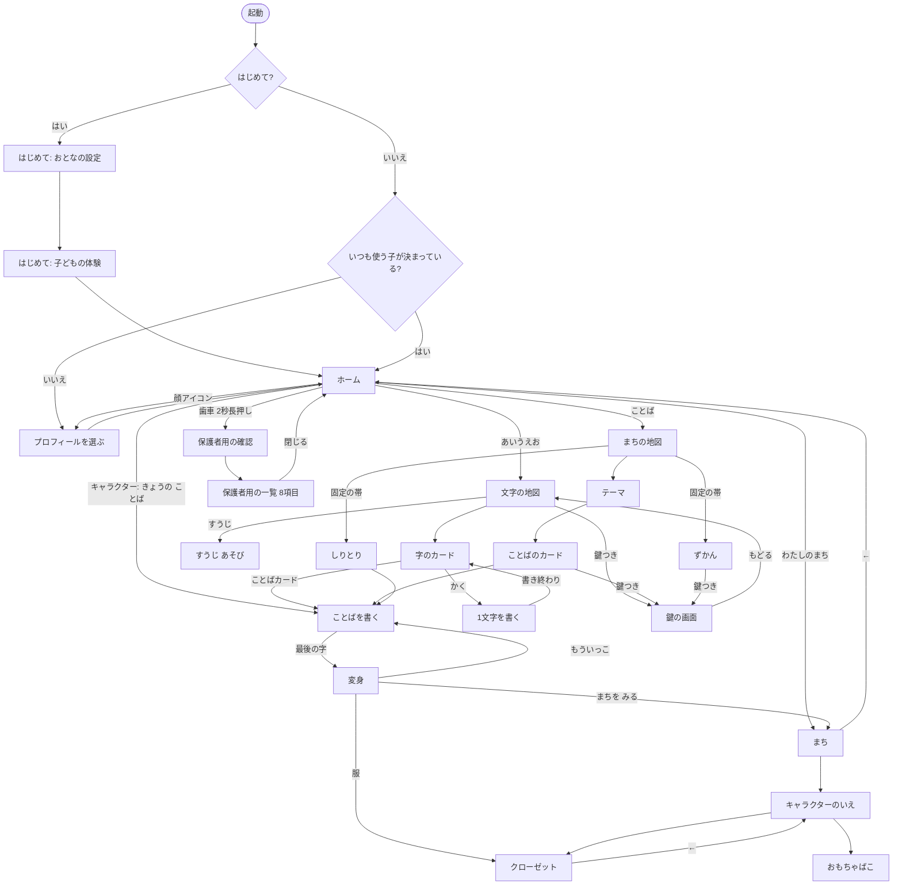

# 画面の表と紙のテスト（D101・D135）

M0 前半の「画面の表と紙のテスト」。決めごとのもとは `docs/design.md` の §3.1（D101）。ここは表と図と手順だけ。決まっていないことは「未定」と書く。

押せる部分の大きさ（D101・D125）:

- 子どもの画面は **2cm 角（約104pt）以上**。「←」も同じ。画面の角に寄せない。
- 文字の地図の字だけ **1.5cm 角（約80pt）以上**。字の間は広めに取る（D125）。
- 保護者用の画面は子どもの決まりの対象外。歯車の入口だけ小さく、2秒長押し（§5.3・D49）。

状態の書き方: **作った** = 設計どおりに近い / **仮** = M0 用の仮の形 / **まだ**。

## 1. 画面の表

### 1.1 子どもの画面

| 画面 | 目的 | 出すもの | 押せるもの | 次に行く画面 | 戻り方 | D | いまのアプリ |
|---|---|---|---|---|---|---|---|
| プロフィールを選ぶ | 使う子を選ぶ | 顔アイコン | 顔アイコン（2cm 角） | ホーム | なし（起動時に出る。切り替えに保護者の確認を求める設定もある。§6.2） | D16・D101 | 仮（上の顔アイコンから出すシート。起動時の画面はまだ） |
| はじめての流れ（おとな） | 最初の設定（4画面。ふつうの日本語。D157） | 「おとなのひとと いっしょに はじめてね」、①呼び名・敬称・顔・利き手 ②判定の4段階（名前と説明） ③歯車の2秒長押しの説明、「子どもたち」から足せること、「記録は この iPad と あなたの iCloud にだけ保存します」、「iCloud に保存する」スイッチ（初期値オン） ④「お子さんに iPad をわたしてください」 | 次へ、あとで設定する（①②）、もどる（②③）、はじめる | 子どもの体験 | ①②は飛ばせる。②③は「もどる」で前の画面へ。④の「はじめる」で後半へ | D23・D54・D157・D161 | 作った（判定の動く見本は未実装） |
| はじめての流れ（子ども） | 最初のごほうびまで案内 | キャラクター選び（とん・るん・ひら）、あいさつ（画面に呼び名）、呼び名の最初の字（なければ「あ」）を みる → なぞる、「なにが すき？」（のりもの・どうぶつ・ふく）、2文字のことば（そり・うし・くつ）、変身、まち | キャラクター、テーマ、「いこう！」、「おうちへ」、「←」（2cm 角） | 変身 → まち → ホーム | 「←」でホームへ抜けられる（その起動のあいだは出さない）。何も練習していない子を選ぶと、ここから始まる | D23・D46・D78・D161 | 作った（キャラクターは描いた絵。選ぶ・あいさつ（手を振る絵）。D164） |
| ホーム | 全部の入口 | ボタン3つ、キャラクター（きょうの ことば）、顔アイコン、きょうの もくひょう、スタンプカード、歯車 | あいうえお、ことば、わたしのまち、キャラクター、顔アイコン（各2cm 角）、歯車（2秒長押し） | 文字の地図、まちの地図、まち、書く画面、プロフィール、保護者用の確認 | なし（最上位） | D101・D17・D166 | 仮（ボタン3つ（「ことば」はまちの地図へ）・顔アイコン・歯車・きょうの もくひょう（星）・スタンプカード（今週の7日）・キャラクター（描いた絵（D164）。目標に届くとよろこぶ絵）と吹き出し。キャラクターを押すと きょうの ことば、は まだ） |
| 文字の地図 | 字を選ぶ | ひらがな・カタカナ・ABC・すうじの4ページ、50音表（あ行が右。D146）、おすすめ順、書けた字のスタンプ | 字（1.5cm 角）、ページのつまみ（2cm 角。絵つき）、「←」 | 字のカード | 「←」でホーム | D101・D125・D146・D90 | 仮（ひらがな・カタカナの2ページ、50音表と「にごる・ちいさい」、4つの色とスタンプ、鍵とおためしの字、狭いときの2分割。ABC・すうじ・おすすめ順のすごろくはまだ。鍵の字を押すと「おとなのひとに おねがいしてね」だけ） |
| 字のカード | 字を書くか、その字のことばを選ぶ | 「かく」の大きなボタン、その字のことばカード | かく、ことばカード、「←」 | 1文字を書く画面、ことばを書く画面 | 「←」で文字の地図 | D101・D35 | 仮（大きな字、「かく」、その字を含むことばカード（絵は SVG のイラスト。D163）。カタカナ・ABC のことばはまだ。おためしのことばカードもまだ） |
| 1文字を書く | みる → なぞる → うすく → じぶんで | マス目、お手本、書き始めの印、ひとつ もどす、ぜんぶ けす、できた！、ペン立て | ツールのボタン（2cm 角以上）、ペン立て、「←」（書いている間と直後1秒は効かない。🏠は出さない） | 次の字、判定の表示、書き終わりの案内 | 「←」で字のカード。書きかけの線は保存 | D46・D47・D56・D101 | 仮（「もじ」の表示。①〜④の段階とごほうびの流れは一部。「←」なし） |
| ことばを書く | ことばを1字ずつ書き、物を完成させる | 影絵（下から、絵のもとの色で色づく。絵は SVG のイラスト）、マス目、できた！、ペン立て | 書くマス、できた！、「←」 | 変身 | 「←」でことばカード。途中の分は残る | D46・D55・D101・D163・D166 | 仮（ことばのカードから入る（選び方と「もういっこ」はそのテーマの中）。「←」あり。書いている間と直後1秒は効かない） |
| 変身 | 書いた線が物になって動く | 変身の動き、キャラクター | 「もういっこ」「まちを みる」（2cm 角以上。服はクローゼットへ直行） | ことばを書く（次）、まち、クローゼット | なし（書いたあとの分かれ道） | D55・D101・D172・D173 | 仮（「もういっこ」「まちを みる」。服は「クローゼットを みる」でクローゼットへ直行。空のことば（くも・あめ など）は、背景の空がその空に変わり、絵が空へ浮かぶ。こうえんの物（ぶらんこ・たいこ など）は、芝生の背景で物が使われ、主人公が そばで はずむ） |
| ことばの入口（まちの地図） | 場所を選ぶ | 12か所の絵、きせつ の はた、下の固定の帯（しりとり・ずかん） | 場所、はた、しりとり、ずかん、「←」 | テーマ、しりとり、ずかん | 「←」でホーム | D101・D53・D67 | まだ |
| テーマ | テーマを選ぶ | 絵カード（多くても12個。場所ごとに1〜4枚） | テーマ、「←」 | ことばのカード | 「←」で まちの地図 | D53・D101・D166 | 作った（絵のあることばがあるテーマだけ出す。絵はそのテーマのことばの絵。おうちは「いえの なか」「クローゼット」の2列。テーマが1つだけの場所は飛ばす） |
| ことばのカード | ことばを選ぶ | 絵カード（多くても12個。絵は SVG のイラスト）、鍵つきの影絵 | カード、「←」 | ことばを書く画面（鍵つきは鍵の画面） | 「←」でテーマ | D53・D101・D163・D166 | 作った（絵カード。鍵つきの影絵は、鍵のことばがないので まだ出さない） |
| しりとり | キャラクターとしりとりで書く | キャラクターの絵カード、候補3枚 | 候補のカード、「もういっかい」、「←」 | ことばを書く画面 | 「←」で まちの地図。1回は5語まで | D45・D70 | まだ |
| ずかん | 集めたことばを見返す | テーマごとの図鑑、★、影絵 | 絵（声で説明）、「←」 | 鍵の画面（影絵の鍵つきを押したとき） | 「←」で まちの地図 | D35・D74・D82 | まだ |
| すうじ あそび | 数字を書く | 未定（「1」だけおためし） | 未定 | 未定 | 未定 | D92 | まだ |
| まち | 集めた物で遊ぶ | 横スクロールのまち、動く物、傾きで転がる物、時刻で変わる景色 | 物、場所へ飛ぶボタン、◀▶、キャラクターのいえ、おもちゃばこ、「←」（2cm 角以上） | キャラクターのいえ、おもちゃばこ | 「←」でホーム | D8・D74・D101・D165・D168・D170・D172・D173 | 仮（画面の1.5〜3枚分の横長のまちを、指1本のドラッグで見て回る。乗り物は道、動物は草、飛ぶ物（ひこうき・ききゅう・鳥）は空を、物ごとの持ち場で動く。動く物は新しい8つまで。景色になる物（花・くだもの・やさい）は丘の手前の草に立つ（新しい12個まで）。水の生きもの（さかな・たこ・かめ など）がいるときだけ、まちの右はしに砂浜と水べが出て、水の中を泳ぐ（新しい6つまで。別に数える。D170）。こうえんの物（ぶらんこ・すべりだい・こま・たいこ など）があるときだけ、まちの左はしに芝生のこうえん（さく・ベンチ・看板「こうえん」）が出て、物が その物らしく動き、主人公が物のあいだを はねて使って遊ぶ（新しい8つまで。別に数える。D173）。空のことば（くも・あめ・ゆき・にじ・ほし など）を書いてから10分のあいだにまちを開くと、空が40秒だけ、その空に変わる（物は増えない。D172）。背景は丘・木・家・雲。場所へ飛ぶボタン・おもちゃばこは まだ。「←」でホーム。服は出ない） |
| キャラクターのいえ | クローゼットとおもちゃばこ | 家具、クローゼット、おもちゃばこ | クローゼット、おもちゃばこ、「←」 | クローゼット、おもちゃばこ | 「←」で まち | D8・D74・D101 | まだ |
| クローゼット | 服を着せる | 服（柄は子どもの線から自動） | 服、「←」 | ― | 「←」でキャラクターのいえ | D8・D101 | 仮（横木に服が揺れるだけの1画面。ホームからは入れず、服を書いたあとだけ。「←」でホーム） |
| 鍵の画面 | 鍵つきの字・ことばを触ったとき | 「この もじは まだ ねむっているよ」、ねむっているキャラクター（選んだキャラクターの ねている絵。D164）、声と字幕「この もじで あそびたいときは、おとなのひとに おねがいしてね」。価格・「かう」・エラーは出さない | 「おとなのひとに おねがいする」（高さ140pt。記録だけ。購入画面は開かない。押すと「おねがい できたよ」を約2秒見せて自動で戻る）、「← もどる」（記録せず戻る） | 元の画面（地図・書く画面のパネル。画面いっぱいに重ねる） | 「← もどる」で元の画面 | D3・D80・D101・D160 | 作った（D164） |
| 保護者用の確認 | おとなだけ通す | かけ算の問題、テンキー | 数字、決定、閉じる | 保護者用の画面の一覧 | 閉じる | D49・D64 | 作った |

### 1.2 保護者用の画面（D116。`NavigationStack` の一覧）

入口は歯車の2秒長押し → かけ算の確認。5分操作がないか閉じたら確認からやり直し（D49）。大きさの決まり（2cm 角）は対象外。VoiceOver と文字サイズに対応する（D116）。

| 画面 | 目的 | 出すもの | 押せるもの | 次に行く画面 | 戻り方 | D | いまのアプリ |
|---|---|---|---|---|---|---|---|
| 保護者用の一覧 | 8項目の入口 | 8項目、お知らせ（上の設定の提案・同期の状態・おねがい。おねがいは「〇〇ちゃんが、カタカナをやりたがっています（11月15日）」。最新の日だけで回数は出さない。買うと消え、「確認した」でも消せる。D160） | 各項目、閉じる | 1〜8の各画面 | 閉じる（ホームに戻る） | D116・D160 | 作った（おねがいのお知らせは作った。ほかのお知らせは未確認） |
| 1 学習記録 | 子どもの様子を見る | 今日 / 今週、文字の地図、苦手な字（再生）、成長アルバム、おねがいの記録、筆圧の傾向。上で子どもを切り替え | 子どもの切り替え、アルバムの保存・共有 | ― | 一覧へ戻る | D25・D83 | 作った |
| 2 子どもたち | プロフィールの管理 | 呼び名、くん・ちゃん・さん、顔、利き手、今日の目標、いつも使う子、切り替えの確認、記録だけリセット、削除 | 各項目、赤いボタン（3秒長押し） | ― | 一覧へ戻る | D16・D64 | 作った |
| 3 判定 | 判定の厳しさ | おまかせの4段階、項目ごとの設定、動く見本。子ども切り替え | 各設定 | ― | 一覧へ戻る | D10・D22 | 仮（おまかせの4段階。動く見本・項目別は未確認） |
| 4 購入 | 商品の購入 | 商品（持っている数で変わる。D95）、購入を復元、子どもが試した字とことば | 買う、復元 | ― | 一覧へ戻る | D89・D95 | 作った（StoreKit。実機の確認は未定） |
| 5 音と表示 | 音量や見え方 | 声・効果音の音量、すべての音を消す、字幕、お手本の速さ、マスの大きさ、筆圧 | 各設定 | ― | 一覧へ戻る | D54 | 作った |
| 6 学習記録の管理 | 同期とバックアップ | 同期の状態、iCloud のデータを消す、全員の記録のリセット | スイッチ、赤いボタン（3秒長押し） | なし | 一覧へ戻る | D44・D63・D64 | 仮（自分の iCloud との同期の入れ切り・状態表示まで実装。署名ありのビルドでの確認（入れ直しで記録が戻るか）はこれから。iCloud のデータを消す（D85。3秒長押し、先にこの iPad の同期をオフ、非公開データベースのゾーンを削除、端末のデータは残す。署名ありで iCloud が使えるときだけ出る）と、2台目の最初の取り込み待ち（D63。最大10秒、「じゅんびちゅう…」の画面）も実装。ほかの iPad が消したと分かったら、同期をオフにして保護者用の画面に知らせ、iCloud のデータを戻さない（D159）。起動のときに置き場所を確かめる流れと、同期のエラー（zoneNotFound・userDeletedZone）が届いたときの流れは、2台のシミュレータで確かめた。アプリを開いたままほかの iPad が消したときの動きは、実機で未確認。消すのは同じ Apple アカウントのどの iPad からでもでき、家族の共有・招待・共有データベースは作らない（D148）） |
| 7 安心のための設定 | 安全の設定 | iPad のパスコードも求めるか、不具合の情報、アクセスガイドとスクリーンタイムの案内 | スイッチ | ― | 一覧へ戻る | D64・D123 | 仮 |
| 8 サポート | 問い合わせなど | この判定はおかしい、ご意見、施設の方へ、プライバシーポリシー、このアプリについて、評価 | 各リンク | メールの下書き、外部リンク、このアプリについて | 一覧へ戻る | D54 | 仮 |

### 1.3 どの画面にもかかわる項目（D101 の「画面の表」の列）

画面ごとに決めるはずの列のうち、設計に書いてあるものと「未定」のもの。紙のテストで決める。

| 項目 | 設計に書いてあること | 未定 |
|---|---|---|
| 声（画面の名前の読み上げ） | その画面に最初の3回入ったときだけ。戻ったときと書く画面では言わない。キャラクターを押せば もう一度（D101） | 画面ごとの言葉 |
| 左きき | 左右を入れ替えるのは書く画面の道具とお手本だけ。「←」は左上に固定（D101・§6.1） | 変身・まちの画面のボタン位置 |
| 縦横 | 文字の地図は10列で約800pt なので縦にも入る（D125）。書く画面の縦横は §6.1 | 各画面の縦横の並べ方 |
| 小さいウィンドウ | 文字の地図は「あ行〜な行」「は行〜わ行」に分ける（どちらもあ行が右の向き。D146）。アルファベットは大文字と小文字を別のページ（D125）。小さすぎるときの画面は D117 | 最小のウィンドウの大きさ。ほかの画面 |
| Mac での操作 | 傾きがなくても押して遊べる（D133）。タッチのない Mac（D135 後半） | 画面ごとの操作 |
| 使わない操作 | ダブルタップ・ピンチ・複数の指・長押し（保護者の入口を除く）。ドラッグにはタップの代わり（D101） | ― |
| 端の操作 | 子どもの全画面で、端の操作の1回目を受け流す（D101・D109） | ― |
| エラー | 子どもの画面に出さない（D117） | ― |

## 2. 画面のつながり

「←」は各画面で一つ前に戻る（左上固定。D101）。上の図では見やすさのため一部だけ描いた。戻り先は表の「戻り方」の列が正。鍵の画面の戻り先は「元の画面」（図は文字の地図だけ描いた）。

## 3. 紙のテストの手順（D101・D135）

目的: アプリを作り込む前に、画面の流れと押す場所が4〜7歳の子に通じるかを、紙で確かめる。M0 前半の条件（D135）のうち、とくに **「変身を見て『もう1回』となる」** と **画面の流れで迷わない** を見る。判定の正しさと遅れは、ここでは測らない（実機で測る。§7.0）。

### 3.1 用意するもの

- 画面の紙。表の子どもの画面ごとに1枚。**iPad の実物の大きさ**（印刷して切る）で、ボタンは 2cm 角以上、文字の地図の字は 1.5cm 角以上に描く。大きさは定規で確かめてから使う。
- 文字の地図は縦向きと小さいウィンドウの2案（D125）を、それぞれ1枚。
- 変身の場面は、絵を描いたカードか、動画を見せる iPad を1台。紙だけだと「もう1回」を見られないので、動く部分は短い動画を代わりにしてよい（D55 の1つの型〔乗り物〕）。
- 太いペン（書く画面の紙用）、記録用紙（下）、ストップウォッチ。可能なら動画で撮る（保護者の同意をとる。D61）。
- 進行役1人（紙を差し替える）、記録役1人（見るだけ。口を出さない）。

### 3.2 進め方

1. 対象は4〜7歳の子2〜3人（できれば4歳と6〜7歳を混ぜる）。保護者の同意をとる。1人15分ほど。
2. 説明はしない。「あそんでみてね」とだけ言う。困っても、まず待つ。10秒たってから「どうしたいかな？」とたずねる。
3. 子どもは指で押す。押した場所を進行役が見て、紙を差し替える。「←」は押したときだけ前の紙に戻す。
4. 課題は下の表の順。1つ終わるごとに次へ。いやがったらやめる。

### 3.3 課題

| 番号 | 課題（子どもに言う言葉） | 見ること | 合格（目安） |
|---|---|---|---|
| 1 | 「ホームから『あ』を かいてみて」 | 押す回数。字は2回、「かく」まで迷わないか（D101） | 説明なしで2回の押しで書く画面に着く |
| 2 | 「きょうの ことばを かいてみて」 | キャラクターを押せたか（1回で着く。D101） | 説明なしで押せる |
| 3 | 「ことばから『そり』（または うし）を かいてみて」 | 4回以内で着くか。ほかの道に入っていないか | 4回以内 |
| 4 | 書いたあとの変身を見せる | 表情、声、「もう1回」と言うか・もう1つ書きたがるか（D135・D61 ②） | 子ども半分以上が自分から「もういっこ」と言う、または押す |
| 5 | 「まちを みてみて」 | 変身した物を見つけて触るか | 見つけて触る |
| 6 | 「もどりたいな」 | 左上の「←」を探せるか。端のスワイプで戻ろうとしないか | 5秒以内に「←」を押す |
| 7 | 文字の地図で「『ね』は どれ？」 | 1.5cm 角の字の押し間違い（D125）。縦向きと2案の比べ | 押し間違いが1回以下 |
| 8 | 左ききの子だけ: 書く画面の道具の位置 | 手で隠れないか（D101・§6.1） | 隠れない |
| 9 | 鍵の画面（鍵つきの字を触る） | 怖がらないか。「おとなのひとに おねがい」を押すか | 泣かない・固まらない |

### 3.4 記録用紙（子ども1人に1枚）

| 項目 | 記録 |
|---|---|
| 日付 / 年齢 / 利き手 / 紙の版 | |
| 課題 | 押した回数 | 迷った秒数 | 押し間違い（どこを押したか） | 言ったこと・表情 | 合格 ○ × |
| 1 字を書く | | | | | |
| 2 きょうの ことば | | | | | |
| 3 ことばから書く | | | | | |
| 4 変身（「もう1回」と言ったか） | | | | | |
| 5 まち | | | | | |
| 6 戻る | | | | | |
| 7 文字の地図 | | | | | |
| 8 左きき | | | | | |
| 9 鍵の画面 | | | | | |
| 気づいたこと（手が止まった所、笑った所、飽きた所） | | | | | |

### 3.5 終わったあと

- 全員分を集め、課題ごとに ○ × を数える。1人でも迷った所は、紙を直してもう一度試す。
- 直す対象: 押した回数が多い道、「←」を探せない配置、押し間違いが多い大きさ、戻れずに固まった所。
- 結果は `docs/design.md` の決定表に新しい D 番号で書き、この表も直す。紙のテストは M0 前半の条件（D135）の「変身を見て『もう1回』となる」を、実機のあとにもう一度確かめる前の下見にもなる。

## 4. 設計の穴と食い違い（紙のテストの前に決めたいこと）

- **ホームのボタンの名前**: §3.1 の絵は「ことば（テーマ / しりとり / ずかん）」、D101 の表は しりとり・ずかんが「まちの地図の下の帯」。この表は D101 に合わせた。絵のほうが古い。
- **はじめての流れの戻り方・飛ばし方**: D161 で決めた（前半は「あとで設定する」と「もどる」、後半は「←」で抜ける）。紙のテストで確かめる。
- **すうじ あそび**: 画面の中身が未定（D92 は「1」だけおためしとだけ書いてある）。
- **キャラクターのいえ・クローゼット・おもちゃばこ**: 画面の並べ方（一覧か部屋か）が未定。
- **2cm 角の対象外**: 歯車（D49）と文字の地図の字（D125）は例外と分かる。保護者用の画面の押せる大きさは、設計に数字がない（未定）。
- **子どもの画面の縦横・最小ウィンドウ**: D125 以外は未定。
